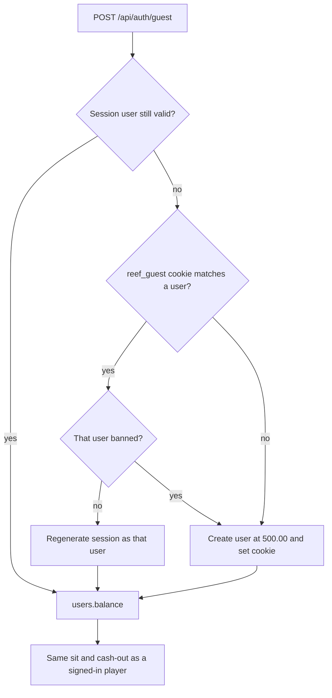

# Guest chips

How a guest keeps the same chip balance across refresh and logout, and where that protection stops.

A guest is a real `users` row. `POST /api/auth/guest` inserts `isGuest: true`, a random username, an unusable password hash, and `balance` `500.00`. After that, sit-down and leave use the same lobby lock, the same seat in `table_games.state`, and the same one-time credit back to `users.balance` as a signed-in player. The guest problem is not the table. The guest problem is the front door. Logout destroys the session. A new "Play as guest" used to insert another row at 500.

The replacement identity is a cookie named `reef_guest`. The value is 32 random bytes, hex encoded. The database stores only the SHA-256 hash, in `users.guest_token_hash`, unique and nullable. The raw token is what the browser can present later. The hash is what the server can look up. A leaked database backup does not contain a token that can be pasted back into a `Cookie` header.

The cookie is `httpOnly`, `SameSite=Lax`, `Path=/`, and it lives for 400 days. Production also sets `Secure`. JavaScript on the page cannot read it, so a casual script cannot copy the guest identity out of `document.cookie`. Logout clears `connect.sid` and leaves `reef_guest` alone. The next guest request hashes the cookie, finds the row, and regenerates the Express session onto that same `userId`. The balance on the row is whatever cash-out and play left there. No second 500 is inserted.

Order matters. A live session wins. If `req.session.userId` still points at a usable account, guest play returns that account and does not mint. That is why a signed-in player who clicks "Play as guest" does not grow a shadow balance. If the open session has no hash yet, the server issues a cookie and saves the hash, so a later logout can still find the row. A cookie that fails the 64-hex check is ignored. A match against a banned user is ignored, and a new guest is created instead of resuming a disabled account.

Registering from that session updates the same row in place: username, email, real password, `isGuest: false`. The id and the decimal balance stay. The cookie still hashes to that row, so a later guest click in the same browser resumes the registered account rather than starting a fresh 500.

This is a browser identity, not an account. Clearing site data, switching browsers, or opening a private window presents no cookie, and the server will create one new guest at 500. That limit is deliberate. A fingerprint or a silent long-term id would follow the person further than a game needs. The cookie is the smallest durable handle that stops refresh and logout from reprinting chips, and it ends when the player throws it away.
