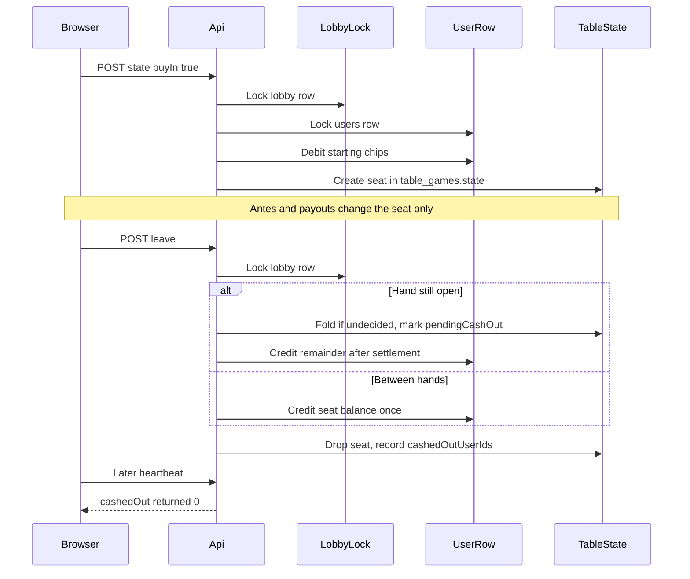

# Signed-in chips

How a registered player's chips move between the account and a shared table, and why that move happens only twice: once on the way in, once on the way out.

A signed-in player already has a durable identity. Email, a bcrypt password, and an Express session cookie point at one `users` row. The chip balance on that row is a PostgreSQL `DECIMAL(12, 2)`. That type is the right place for money that has to survive a restart, a second browser tab, and a login tomorrow. Integer cents would also work, but the account column was already decimal, and every credit or debit goes through a cents conversion at the boundary so a float never becomes the stored value.

The table does not play against that column directly. A hand is a burst of antes, raises, folds, and a dealer result, and several of those updates happen inside one second while a timer is also advancing the same lobby. Putting every chip change on `users.balance` would make the account the hot row for the whole hand. Instead, `sharedTable` locks the lobby row, copies `table_games.state` (JSONB), and keeps the live stack on the seat inside that document. Sequelize writes the document back in the same transaction as the account update. If settlement throws, the debit or the credit rolls back with the hand.

Joining a lobby only checks that the account can cover `startingMoney`. The debit waits until this player opens the table. A heartbeat from the clock, or from someone else at the table, cannot create the seat. The first sync that belongs to the player locks `users` with `SELECT … FOR UPDATE`, subtracts the buy-in, and inserts a seat whose balance is that same amount in cents. If the account is short, the seat is never created and the transaction throws. An existing seat is treated as already funded. Reopening the same hand, or polling every two seconds, does not charge again.

Leaving is the only path back to the account. Between hands, the seat balance is added to `users.balance`, the seat is marked cashed out, and the id is stored on `cashedOutUserIds` inside the same JSON document. During a hand, an undecided player folds and a raise that was already submitted stays locked. The seat is flagged `pendingCashOut`. When the hand settles, the remainder — including the locked raise — is credited once, then the seat is dropped. The lobby lock makes the two leave requests line up. The second one finds no uncashed seat, so the response is `{ cashedOut: true, returned: 0 }` and the decimal column does not move. A later heartbeat is the same story. The client sends `buyIn: true` only when the player opens the table again, which is a new debit, not a replay of the old one.

Practice chips and the tutorial stay outside this path. Practice lives on the Express session as `practiceGame`. Tutorial chips live in React state. Neither writes `users.balance`. The account is the pile that login can find again.
