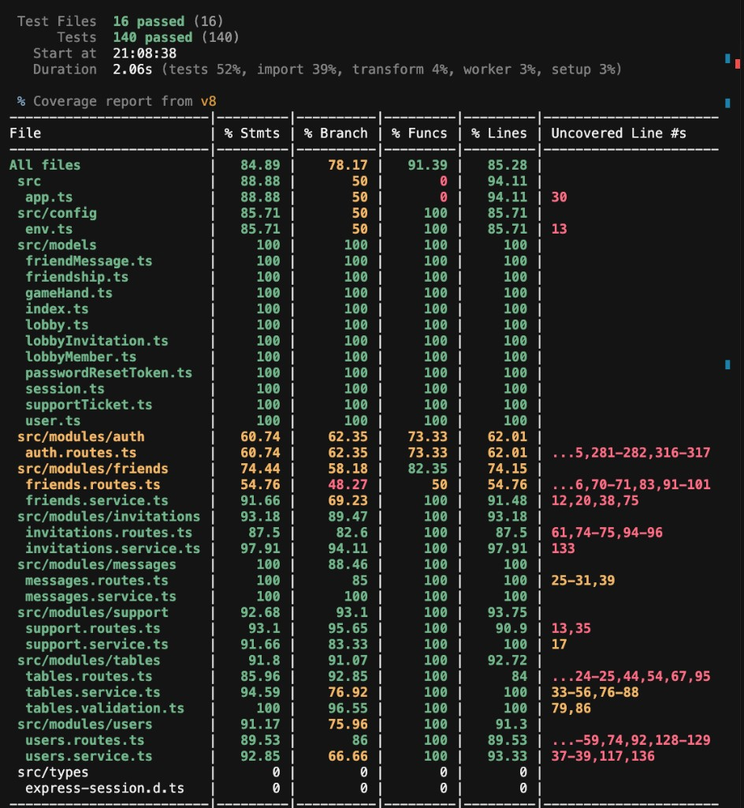
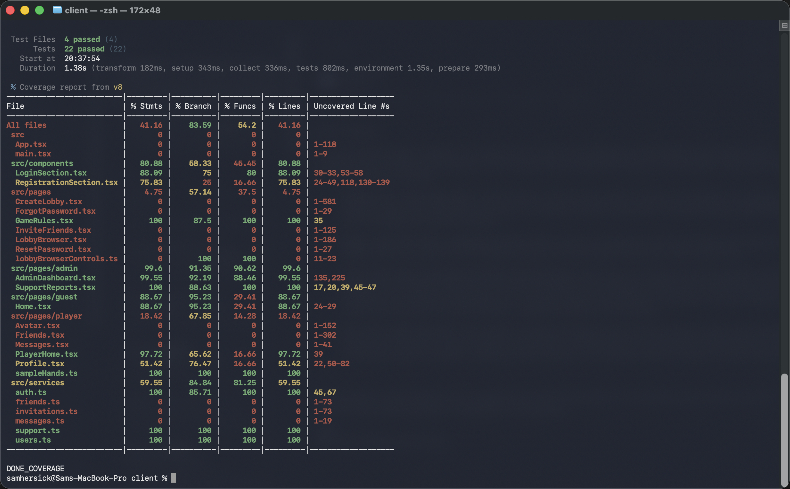

# S23 and S24 coverage

**Date:** 02 November 2026
**Author:** Sam Hersick

**Server** — `npm run test:coverage` in `server/`

**Client** — `npm run test:coverage` in `client/`

## Results

| Package | Tests | Statements | Branches | Functions | Lines |
| --- | --- | --- | --- | --- | --- |
| Server | 140 passed, 16 files | 84.89% (635/748) | 78.17% (369/472) | 91.39% (85/93) | 85.28% (603/707) |
| Client | 22 passed, 4 files | 41.16% (1009/2451) | 83.59% (270/323) | 54.20% (58/107) | 41.16% (1009/2451) |

Earlier client coverage in `Docs/iteration-2-olu.md` was 15.18% statements. The first admin player tests raised that to 32.25% (7 tests). The dashboard suite raised it again to 41.16%. Many other client pages still have no tests, so the client figure is not an overall assignment target.

## Admin dashboard files

| File | Statements | Branches | Functions | Lines |
| --- | --- | --- | --- | --- |
| `client/src/pages/admin` (both pages) | 99.60% (501/503) | 91.35% (169/185) | 90.62% (29/32) | 99.60% (501/503) |
| `AdminDashboard.tsx` | 99.55% (450/452) | 92.19% (130/141) | 88.46% (23/26) | 99.55% (450/452) |
| `SupportReports.tsx` | 100% (51/51) | 88.63% (39/44) | 100% (6/6) | 100% (51/51) |
| `client/src/services/auth.ts` | 100% (64/64) | 85.71% (12/14) | 100% (5/5) | 100% (64/64) |
| `client/src/services/users.ts` | 100% (81/81) | 100% (11/11) | 100% (5/5) | 100% (81/81) |
| `client/src/services/support.ts` | 100% (17/17) | 100% (5/5) | 100% (3/3) | 100% (17/17) |
| `server` users module | 91.17% (155/170) | 75.96% (79/104) | 100% (22/22) | 91.30% (147/161) |
| `server` support module | 92.68% (38/41) | 93.10% (27/29) | 100% (7/7) | 93.75% (30/32) |
