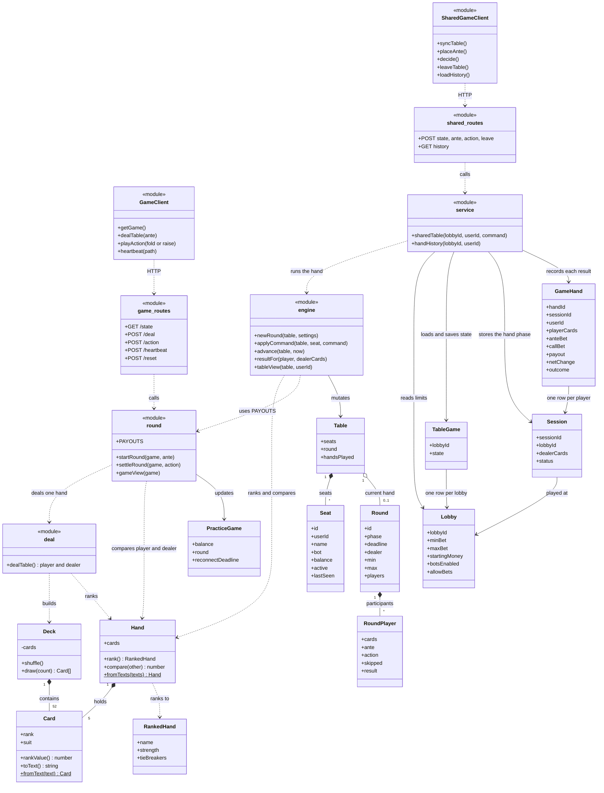

# System Design

## Diagrams

### Gameplay class diagram

Simplified view of the types that run a Caribbean Stud hand. `Card`, `Hand`, `Deck`, `GameHand`, `TableGame`, `Session`, and `Lobby` are classes in the code. `deal`, `round`, `game.routes`, `engine`, `service`, `shared-game routes`, and the two client services are modules; this diagram treats each module as a class.

Both play paths share the same cards, hand ranking, and payout table. Solo practice keeps one hand on the login session. A shared table keeps seats, bets, and the current hand in `TableGame`, then writes the finished hand to `Session` and `GameHand`.

`Session` here is the `game_sessions` row for one shared hand. Login cookies stay outside this diagram.
